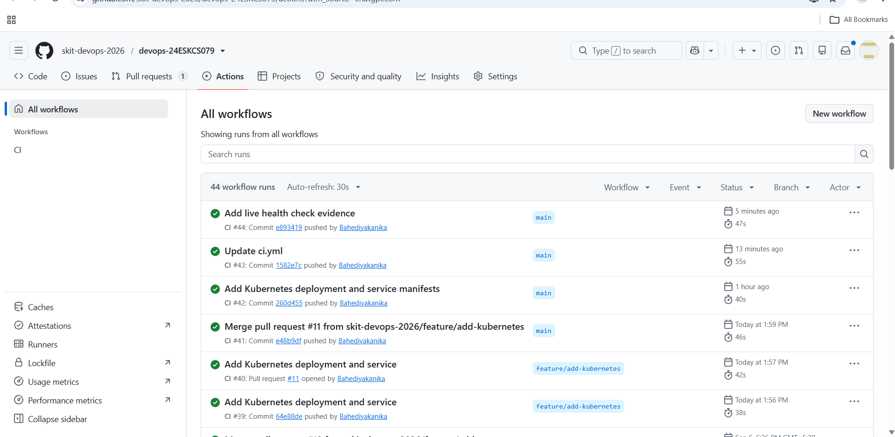
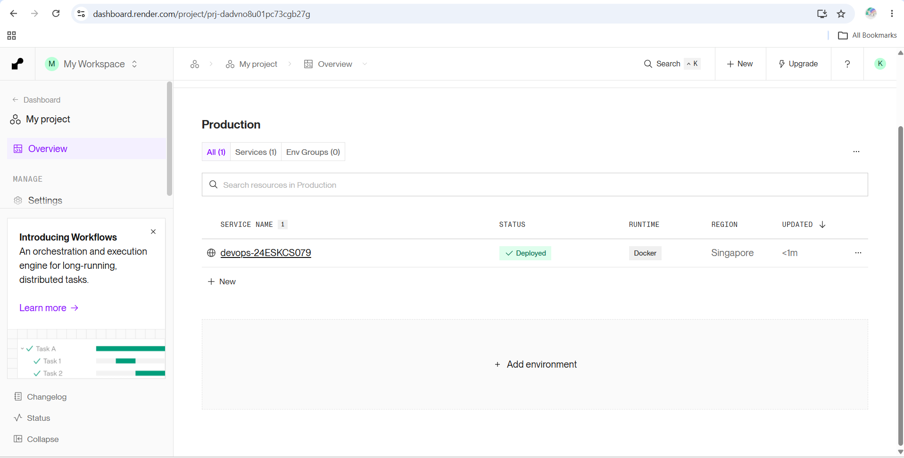
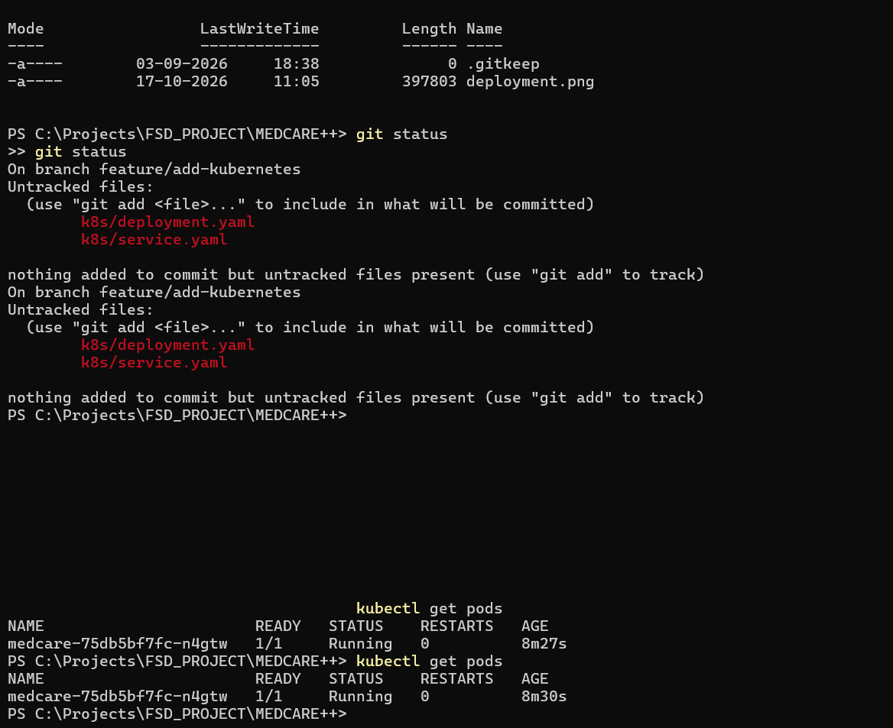
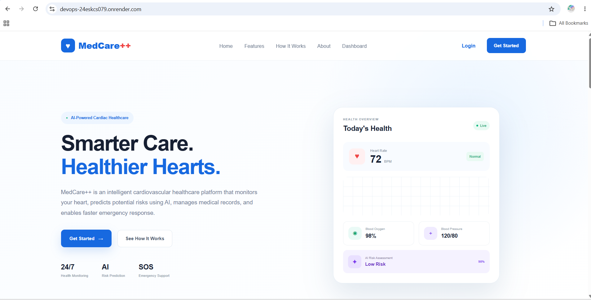

# MedCare++

> A smart healthcare monitoring platform designed to help users monitor
> cardiovascular health and access important healthcare information through
> a simple web interface.

## Author

| Roll No. | Name | GitHub username |
|---|---|---|
| 24ESKCS079 | Kanika Bahediya | Bahediyakanika |

## About

MedCare++ is a web-based healthcare monitoring platform focused on
cardiovascular health and patient monitoring. It provides a user-friendly
interface for accessing health information, monitoring heart-related data,
and supporting better healthcare awareness.

The project is developed as a DevOps-enabled application with automated
testing, continuous integration, containerization, deployment, and monitoring
practices.

## Tech Stack

- Frontend: HTML, CSS, JavaScript, Tailwind CSS
- Backend: Not implemented
- Database: Not implemented
- Web Server: Nginx
- Containerization: Docker, Docker Compose
- CI: GitHub Actions
- CI/CD Pipeline: GitHub Actions
- Deployment: Render
- Testing: Node.js built-in test runner

## Project Structure

```text
MEDCARE++/
├── .github/
│   └── workflows/
│       └── ci.yml
├── index.html
├── login.html
├── dashboard.html
├── heart-monitor.html
├── script.js
├── style.css
├── dashboard.css
├── heart-monitor.css
├── images/
├── src/
│   ├── input.css
│   └── output.css
├── tests/
│   └── medcare.test.js
├── scripts/
│   └── hygiene.sh
├── docs/
├── monitoring/
├── k8s/
├── Dockerfile
├── docker-compose.yml
├── nginx.conf
├── Jenkinsfile
├── Makefile
├── package.json
└── README.md
```

## Running Locally

Install dependencies:

```bash
make install
```

Run the application locally:

```bash
make run
```

The application can then be accessed through the local development server.

## Testing

Automated tests are included to verify important MedCare++ project
requirements.

Run the test suite using:

```bash
make test
```

The test suite checks:

- MedCare++ landing page title
- Required application pages
- Tailwind CSS configuration

## Build

Build the Tailwind CSS output using:

```bash
make build
```

## Docker

Build the Docker image:

```bash
docker build -t medcare-app .
```

Run the Docker container:

```bash
docker run -d -p 8080:80 --name medcare-health medcare-app
```

The application will be available at:

```text
http://localhost:8080
```

Health check endpoint:

```text
http://localhost:8080/health
```

## Docker Compose

The application can also be started using Docker Compose:

```bash
docker compose up --build
```

To stop the services:

```bash
docker compose down
```

## CI Pipeline

GitHub Actions is used for continuous integration.

The CI pipeline performs:

1. Repository hygiene checks
2. Dependency installation
3. Automated tests
4. Application build
5. Docker image build
6. Docker image push to GitHub Container Registry

The workflow configuration is available at:

```text
.github/workflows/ci.yml
```

## Jenkins Pipeline

Jenkins is used to automate the local CI pipeline.

The Jenkins pipeline performs:

1. Dependency installation
2. Automated testing
3. Application build

The pipeline configuration is available in:

```text
Jenkinsfile
```

## Deployment

MedCare++ is deployed as a Docker-based web service using Render.

### Live URL

https://devops-24eskcs079.onrender.com

### Health Endpoint

The deployed application provides a health-check endpoint:

```text
https://devops-24eskcs079.onrender.com/health
```

The `/health` endpoint returns HTTP 200 when the application is running
correctly.

## DevOps Practices

This project demonstrates the following DevOps practices:

- Git-based version control
- Feature branches
- Pull requests
- Continuous Integration
- Automated testing
- Build automation
- Jenkins pipeline
- Docker containerization
- Docker Compose
- Container image publishing
- Cloud deployment
- Application health checks
- Monitoring configuration
- Kubernetes deployment configuration

## Repository

The project repository is maintained under the SKIT DevOps organization:

```text
skit-devops-2026/devops-24ESKCS079
```
## Deployment Evidence

**GitHub Actions — CI/CD Pipeline**



**Render — Live Deployment**



**Kubernetes — Running Pods**



**Application Deployment**


**Health Check**

The live health endpoint was verified to return HTTP 200 OK.

See the captured response in [docs/health-check.txt](docs/health-check.txt).
